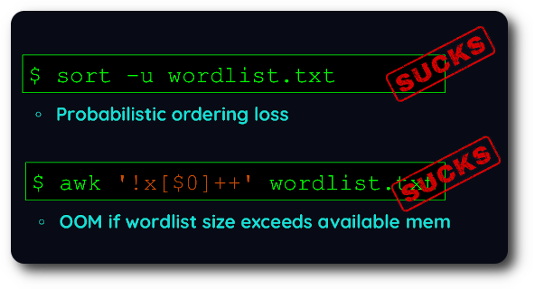
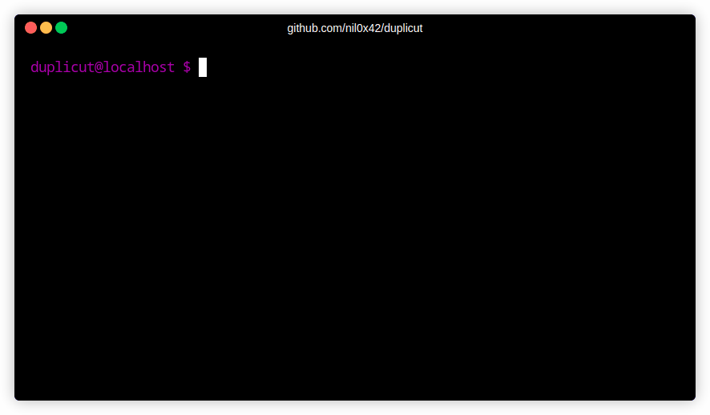

<h1 align="center">Duplicut :scissors:</h1>

<h3 align="center">
    Quickly dedupe massive wordlists, without changing the order
    <a href="https://twitter.com/intent/tweet?text=Duplicut%3A%20Remove%20duplicates%20from%20MASSIVE%20wordlist%2C%20without%20sorting%20it%20(for%20dictionnary-based%20password%20cracking)%20-%20by%20%40nil0x42&url=https://github.com/nil0x42/duplicut">
      
    </a>
</h3>
<br>

<p align="center">
  <a href="https://github.com/nil0x42/duplicut/actions/workflows/tests.yml?query=branch%3Amaster" target="_blank">
    
  </a>
  <a href="https://app.codacy.com/gh/nil0x42/duplicut/dashboard" target="_blank">
    
  </a>
  <a href="https://github.com/nil0x42/duplicut/actions/workflows/codeql.yml?query=branch%3Amaster" target="_blank">
    
  </a>
  <a href="https://codecov.io/gh/nil0x42/duplicut" target="_blank">
    
  </a>
</p>

<p align="center">
  <a href="https://github.com/enaqx/awesome-pentest#hash-cracking-tools" target="_blank">
    
  </a>
  <a href="https://inventory.raw.pm/tools.html#Duplicut" target="_blank">
    
  </a>
  <a href="https://www.blackarch.org/misc.html" target="_blank">
    
  </a>
  <a href="https://x.com/intent/follow?screen_name=nil0x42" target="_blank">
    
  </a>
</p>

<div align="center">
  <sub>
    Created by
    <a href="https://twitter.com/nil0x42">nil0x42</a> and
    <a href="https://github.com/nil0x42/duplicut/graphs/contributors">contributors</a>
  </sub>
</div>

<br>

* * * * * * * * * * * * * * * * * * * * * * * * * * * * * * * * * * *

<a href="#"></a>

### :book: Overview

Duplicut removes duplicate lines from massive wordlists **without changing their
order**. Keep the first occurrence of each word, even when the file exceeds RAM.

When combining password wordlists, the most likely candidates should stay first.
Sorting changes that priority; keeping every unique word in memory can exhaust
RAM. Duplicut is written in optimized C and automatically chooses between
chunk-based scans and disk partitions to fit the available resources.

<br clear="all">
<a href="#"></a>
<br>

* * * * * * * * * * * * * * * * * * * * * * * * * * * * * * * * * * *

<a name="quick-start"></a>
### :bulb: Quick start

```sh
git clone https://github.com/nil0x42/duplicut  # download
cd duplicut && make                         # compile
./duplicut wordlist.txt > clean-wordlist.txt # dedupe
```

Prefer a ready-to-run binary? Download the matching Linux or macOS binary from
the [latest release](https://github.com/nil0x42/duplicut/releases/latest).
Linux and macOS builds are available for x64 and ARM64.
[Build and installation details](doc/development.md#building).

<a name="options"></a>
### :wrench: Options

Run `./duplicut --help` for command-line help. Input comes from a named file or,
when omitted, from stdin. Results go to stdout unless `-o` is given; progress and
diagnostics go to stderr.

| Use | Option | Behavior |
|---|---|---|
| Output | `-o, --outfile FILE` | Write to a file instead of stdout. |
| | `-D, --dupfile FILE` | Save removed duplicate occurrences; adds I/O. |
| Resources | `-m, --memlimit VALUE` | Working-memory budget, e.g. `100M` or `2G`; defaults to available memory. |
| | `-t, --threads NUM` | Maximum worker threads; defaults to online CPUs. |
| Filtering | `-l, --line-max-size NUM` | Maximum line length in bytes; default 1024, maximum 4095. |
| | `-p, --printable` | Keep only printable ASCII lines. |
| Case | `-c, --lowercase` | Convert to lowercase before deduplication. |
| | `-C, --uppercase` | Convert to uppercase before deduplication. |
| Engine | `-e, --engine ENGINE` | `auto` (default), `mmap-chunks` or `disk-partitions`. |
| Information | `-h, --help` | Show help. |
| | `-v, --version` | Show version and license information. |

### :bulb: Common uses

```sh
# Combine lists while preserving their priority
cat preferred.txt extra.txt | ./duplicut > combined.txt

# Normalize case and keep printable ASCII
./duplicut -cp wordlist.txt > clean-wordlist.txt

# Set a working-memory budget and save duplicate occurrences
./duplicut -m 100M -D duplicates.txt wordlist.txt -o unique.txt

# Append the result of this run to an existing file
./duplicut wordlist.txt >> combined.txt
```

Append mode deduplicates the new input, not the existing destination contents.
See the [usage guide](doc/usage.md) for line handling and output behavior, and
[memory and disk use](doc/resources.md) for what the memory budget covers.

### :zap: Observed performance

On a **laptop with 16 GB RAM and an NVMe SSD**:

| Workload | Observed time |
|---|---:|
| Real wordlist: about 285 million lines, 2.58 GiB | **~36 seconds** |
| Generated wordlist: 20 GiB, larger than RAM | **~2 min 20 seconds** |

These are measured workloads, not a throughput guarantee.
[Workloads, options and measurement details](doc/performance.md).

### :book: Documentation

[Documentation index](doc/README.md) · [How it works](doc/architecture.md) ·
[Troubleshooting](doc/troubleshooting.md) · [Development](doc/development.md)
