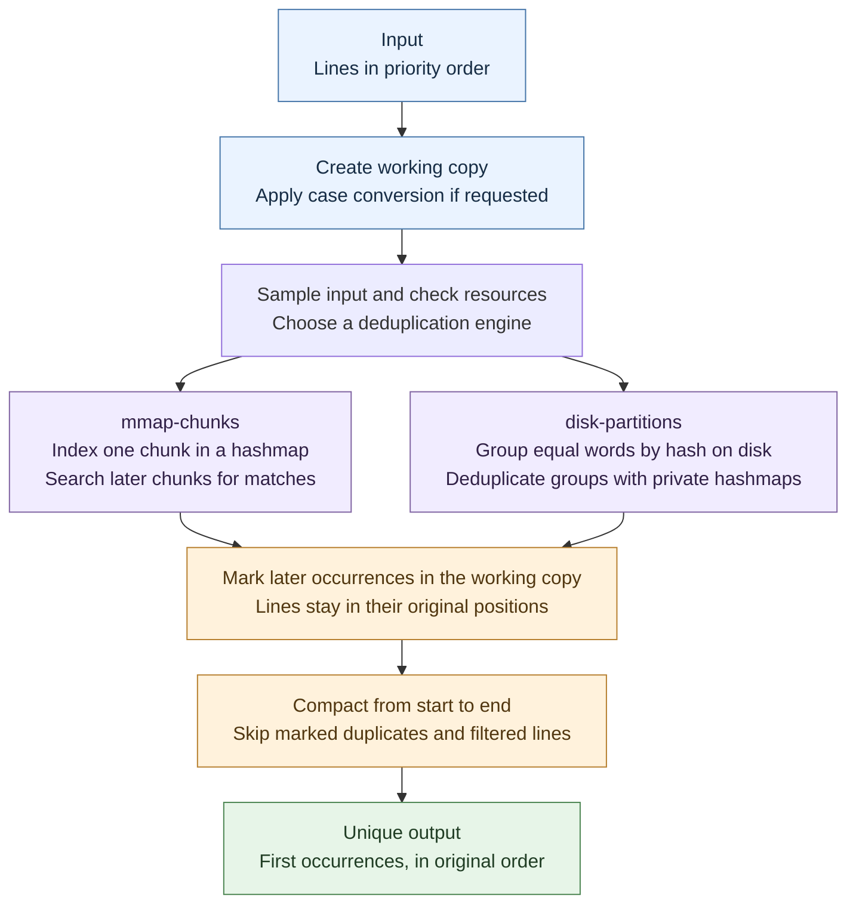

# How Duplicut works

[Documentation](README.md) · [mmap-chunks](engines/mmap-chunks.md) · [disk-partitions](engines/disk-partitions.md)

Both engines identify later occurrences of an accepted line and mark them for
removal. They differ in where comparisons happen, not in what the result means.
The [line and normalization rules](usage.md#line-handling) apply to both.

## Shared workflow

Filtering happens through the same line reader during processing and cleanup;
it does not require a separate filtered copy. Once duplicates have been marked,
compaction moves surviving contents toward the start of the working file. The
file is shortened and, if necessary, the result is copied to its destination.

## Shared example

Use this small input to follow both engine pages. Assume the default,
case-sensitive comparison:

| Input position | Contents | Result |
|---:|---|---|
| 1 | `alpha` | Keep |
| 2 | `beta` | Keep |
| 3 | `alpha` | Remove: repeats position 1 |
| 4 | `gamma` | Keep |
| 5 | `beta` | Remove: repeats position 2 |

The output is `alpha`, `beta`, `gamma`, in that order. How workers are scheduled
must not change which occurrence survives.

## Hashmaps and exact matches

A **hashmap** is a table that makes a line quick to look up. A hash computed
from the contents chooses an initial slot. If that slot is occupied by another
line, Duplicut checks subsequent slots: this is **linear probing**.

A matching hash or slot is not proof of equality. Duplicut compares the line
length and actual bytes. Hash collisions therefore affect search work, not the
correctness of duplicate detection.

The **load factor** is the fraction of occupied slots. Keeping headroom avoids
long probe chains. Each engine has a bounded way to continue when its table or
content capacity is reached, described on its own page.

## Line references

A hashmap entry is a reference to line contents, not a stored hash or a copy of
the complete word. On supported 64-bit builds, one eight-byte entry packs:

| Bits | Contents |
|---|---|
| 63–12 | 52-bit address |
| 11–0 | 12-bit byte length |

This representation assumes that the upper 12 address bits are zero. The length
field explains the supported [line-length limit](../README.md#options).

For mmap, the address points into the working file's mapping. For partitions,
it points into that worker's private content buffer. An empty slot is zero.

## Working file and output

**Memory mapping** exposes file contents through an address range. It does not
load the entire file into physical RAM at once: the operating system brings
pages into memory as they are accessed.

Duplicut maps its working copy with shared writes. A suitable regular output
file can serve as that copy. Other destinations require a temporary working
file; a large RAM-backed output may also use disk working storage before
receiving just the final result. The [output modes](usage.md#output-files-and-streams)
and [resource guide](resources.md) explain these choices.

Both engines eventually mark duplicates by replacing their first byte with the
reserved NUL marker. Final compaction skips those marks and filtered lines.
Partition workers first record their decisions in a bitmap, then apply the
marks in a source-order scan.

For the differences in scans, storage and parallelism, continue with the two
[engine explanations](README.md#understand-the-engines).
