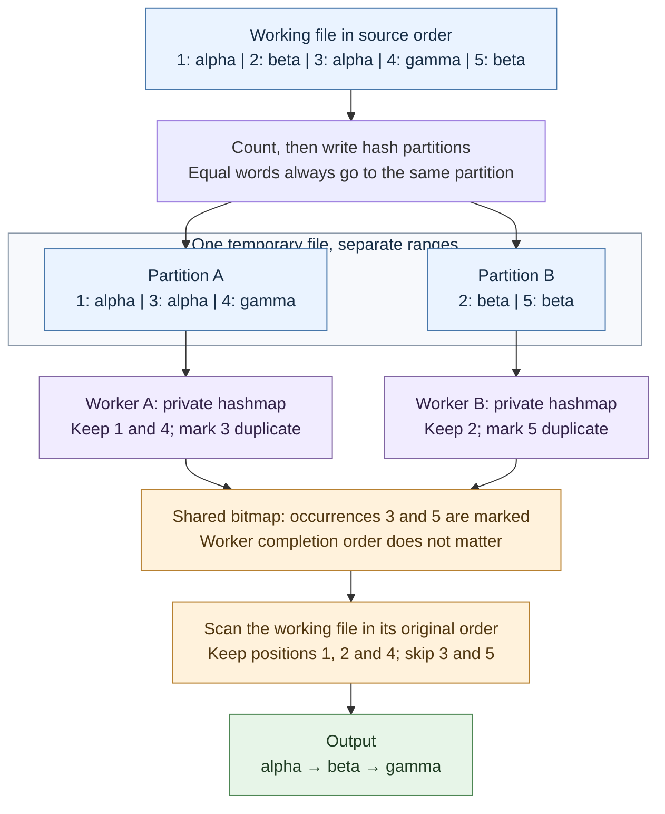

# disk-partitions

[Documentation](../README.md) · [Shared workflow](../architecture.md) · [mmap-chunks](mmap-chunks.md)

This engine groups accepted occurrences into hash partitions on disk, then
processes independent partitions with private hashmaps. A bitmap records which
occurrences are duplicates. Applying that bitmap to the working file preserves
source order, regardless of worker scheduling.

## Count and plan

An initial scan counts accepted occurrences and their serialized bytes in each
partition. This determines the exact bitmap size and file ranges before writes
begin. Duplicut checks usable memory and temporary storage, and may reject the
candidate in [automatic mode](../engine-selection.md#confirmation-and-fallback).

A partition is a contiguous range inside **one temporary file**, not a separate
file per worker or per group. The partition count is a power of two; bits from
the line's hash select its range.

## Write records

A second source-order scan writes each accepted line into its chosen partition.
Identical contents always choose the same partition. Different contents may
choose it too, so workers still perform exact comparisons.

Each internal record contains:

| Field | Size | Purpose |
|---|---:|---|
| Occurrence ID | 8 bytes | Zero-based index among accepted occurrences |
| Content length | 2 bytes | Number of content bytes |
| Contents | Variable | The actual line, without its separator |

The fixed overhead is ten bytes per accepted occurrence. Records retain their
relative input order within each partition. Buffers collect writes instead of
issuing a syscall for every small field. This is an internal, temporary format,
not an exported file format.

For the [shared example](../architecture.md#shared-example), a possible routing is:

| Partition | Input positions and contents |
|---|---|
| A | 1: `alpha`, 3: `alpha`, 4: `gamma` |
| B | 2: `beta`, 5: `beta` |

The actual partition labels depend on hashes; this example illustrates the
required grouping rather than particular hash values.

## Deduplicate locally

Each worker takes a partition and processes its records in order. It owns:

- a hashmap of [line references](../architecture.md#line-references);
- a buffer holding the contents referenced by that table;
- small I/O and line buffers.

The table is kept at no more than 50% load. When a record matches a stored line,
the worker marks its occurrence ID as duplicate. If an unseen record cannot fit
in the table or content buffer, it is deferred inside the same partition range.

After the pass, the worker clears its table and processes the deferred records.
These overflow passes bound memory without requiring recursive partition files.
The first deferred occurrence still precedes its later copies, so the first
occurrence remains the one retained.

## Preserve order with a bitmap

A **bitmap** stores one bit per accepted occurrence. A set bit means “remove this
occurrence.” Workers update their bits atomically, including when separate IDs
share a bitmap byte.

In the example, A marks position 3 and B marks position 5. B may finish first;
that does not make `beta` the first output line.

A final source-order scan checks the bits and marks duplicate lines in the
working file. The shared compaction produces `alpha`, `beta`, `gamma`. The output
is never assembled by concatenating processed partitions.

## Cost and suitable workloads

Partitioning replaces many full-file searches with grouping and local work.
It also allows concurrent insertion into independent tables. Its cost is the
counting scan, partition writes and reads, the marking scan, and any overflow
passes.

The temporary file contains every accepted occurrence, including duplicates;
it is not sized from the final number of unique words. Short words have a large
relative record overhead. A large bitmap can also leave too little private
memory, making overflow costly.

See [resource accounting](../resources.md#partition-storage) for sizes and
[automatic selection](../engine-selection.md) for admission rules.
