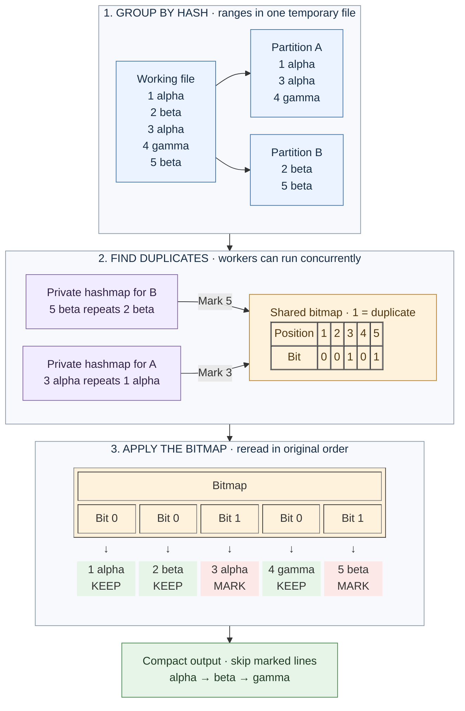

# disk-partitions

[Documentation](../README.md) · [Shared workflow](../architecture.md) · [mmap-chunks](mmap-chunks.md)

This engine groups accepted occurrences into hash partitions on disk, then
processes independent partitions with private hashmaps. A bitmap records which
occurrences are duplicates. Applying that bitmap to the working file preserves
source order, regardless of worker scheduling.

## Group, compare, preserve order

Equal lines always enter the same partition. Numbers below are input positions
from the [shared example](../architecture.md#shared-example); A and B illustrate
one possible hash routing.

## Count and plan

An initial scan counts accepted occurrences and their serialized bytes in each
partition. This determines the exact bitmap size and file ranges before writes
begin. Duplicut checks usable memory and temporary storage, and may reject the
candidate in [automatic mode](../engine-selection.md#confirmation-and-fallback).

A partition is a contiguous range inside **one temporary file**, not a separate
file per worker or per group. The partition count is a power of two; bits from
the line's hash select its range.

## Write records

A second source-order scan writes each accepted line into its chosen partition.
Different contents can share a partition, so workers still compare actual bytes.

Each internal record contains:

| Field | Size | Purpose |
|---|---:|---|
| Packed index and length | 5–10 bytes | Zero-based occurrence index and 12-bit content length |
| Contents | Variable | The actual line, without its separator |

One header width is chosen for the whole run from the exact accepted occurrence
count: five bytes through 2²⁸ occurrences, then one more byte per eight additional
index bits. Records retain their input order within each partition. Buffers
collect writes instead of issuing a syscall for every small field.

## Deduplicate locally

Each worker takes a partition and processes its records in order. It owns:

- a hashmap of [line references](../architecture.md#line-references);
- a buffer holding the contents referenced by that table;
- small I/O and line buffers.

The table is kept at no more than 50% load. When a record matches a stored line,
the worker marks its occurrence ID as duplicate. If an unseen record cannot fit
in the table or content buffer, it is deferred inside the same partition range.

After the pass, the worker clears its table and processes the deferred records.
These overflow passes bound memory without requiring recursive partition files.
The first deferred occurrence still precedes its later copies, so the first
occurrence remains the one retained.

## Preserve order with a bitmap

Workers update the shared bitmap atomically, including when separate occurrence
IDs share a byte. A source-order scan applies its set bits as duplicate marks in
the working file, before the [shared compaction](../architecture.md#working-file-and-output).

## Cost and suitable workloads

Partitioning replaces many full-file searches with grouping and local work.
It also allows concurrent insertion into independent tables. Its cost is the
counting scan, partition writes and reads, the marking scan, and any overflow
passes.

The temporary file contains every accepted occurrence, including duplicates;
it is not sized from the final number of unique words. Short words have a large
relative record overhead. A large bitmap can also leave too little private
memory, making overflow costly.

See [resource accounting](../resources.md#partition-storage) for sizes and
[automatic selection](../engine-selection.md) for admission rules.
