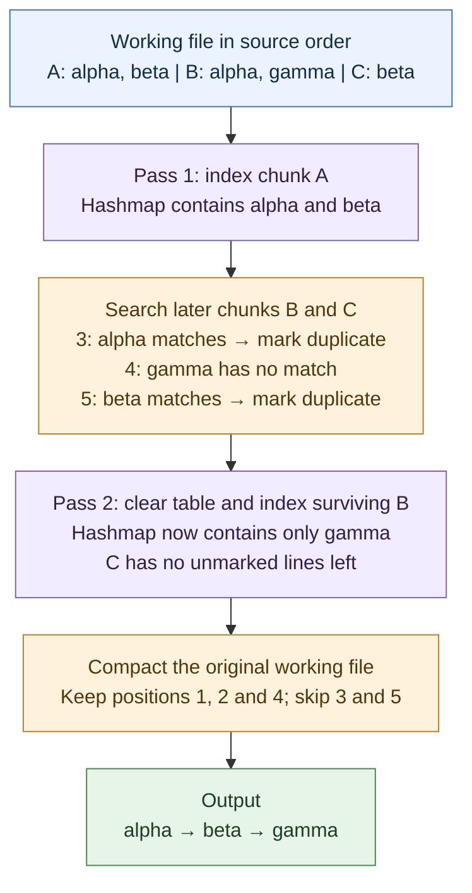

# mmap-chunks

[Documentation](../README.md) · [Shared workflow](../architecture.md) · [disk-partitions](disk-partitions.md)

This engine builds a hashmap from one chunk of the working file, then searches
the following chunks for matching lines. It repeats with the next chunk until
all input has been handled. Entries reference mapped contents, so the hashmap
does not need its own copies of the words.

## One table, successive chunks

A **chunk** is a contiguous portion of the working file. Its nominal size comes
from the [memory and density estimates](../resources.md#table-and-chunk-sizing).
Boundaries extend to the next newline, keeping a line in one chunk.

For the [shared example](../architecture.md#shared-example), imagine three chunks:

| Chunk | Input positions |
|---|---|
| A | 1–2 |
| B | 3–4 |
| C | 5 |

1. Populate the hashmap from A. It contains `alpha` and `beta`; repeats inside
   A would already be marked during insertion.
2. Search B and C against that table. Position 3 matches `alpha`, and position 5
   matches `beta`; both are marked.
3. Clear the table and populate it from the surviving lines in B: only `gamma`.
4. Search C against this new table, then continue. Already marked lines are skipped.

Matches use [length and byte comparisons](../architecture.md#hashmaps-and-exact-matches).
The engine only marks later occurrences. It does not move lines until the
shared compaction step, so the first occurrence and output order are preserved.

## Bounded insertion

The table targets 50% load when chunks are sized. Insertion stops before a new
entry would exceed the 70% limit. Existing matches can still be identified
without inserting another entry.

If a chunk is denser than estimated, the populated prefix is used to search its
unindexed remainder and the later chunks. Duplicut then clears the table and
continues from the first unindexed line. This creates additional passes rather
than filling the hashmap to the point where probing becomes extremely slow.

## Parallel work

Population of the current table is serial. Once populated, the table is read
by lookup workers scanning separate subsequent chunks. Workers mark duplicates
in their own ranges and finish before that table is replaced.

With one whole-file chunk, there are no later chunks to search: this engine
primarily performs serial insertion. More requested threads do not make that
insertion concurrent.

## Cost and suitable workloads

With `n` nominal chunks and no saturation, indexing and later-chunk searches
schedule up to `n(n+1)/2` tasks. Marked lines and empty tables can reduce useful
work; saturation can add tasks. This count is not a timing prediction.

The advantage is avoiding the partition file and its full-content copies.
Whole-file processing and cached long lines can therefore be efficient. With
many chunks, repeated scans of the remaining input become expensive, especially
when pages cannot stay in RAM.

Compare the [partition strategy](disk-partitions.md), or read how
[automatic selection](../engine-selection.md) weighs these costs.
