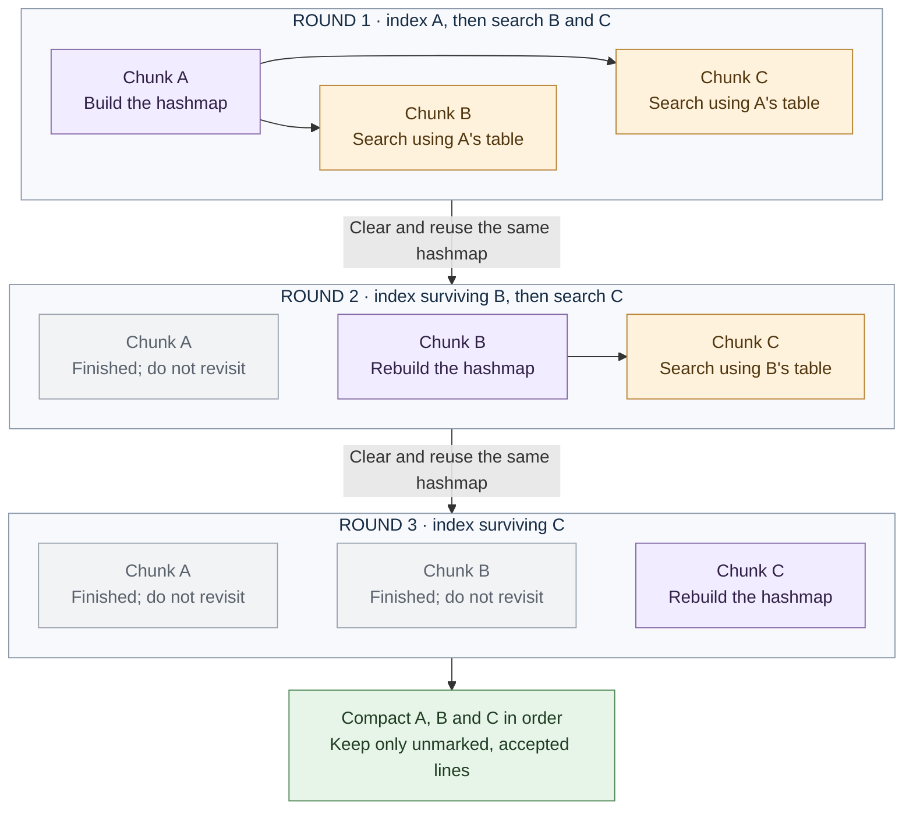

# mmap-chunks

[Documentation](../README.md) · [Shared workflow](../architecture.md) · [disk-partitions](disk-partitions.md)

This engine builds one hashmap from the current chunk, then searches later
chunks for duplicates. Entries [reference mapped lines](../architecture.md#line-references),
so the table does not need its own copies of the words.

Chunks are consecutive ranges of the working file, with boundaries extended to
the next newline. Their [nominal size](../resources.md#table-and-chunk-sizing)
depends on the memory budget and sampled line density.

## One table, successive chunks

1. **Index the current chunk:** insert its surviving lines into the hashmap,
   marking repetitions within that chunk.
2. **Search later chunks:** mark matches against that table. Searches do not
   insert new entries; nonmatching lines remain for later rounds.
3. **Advance:** after all searches finish, clear the table and index the next
   chunk's surviving lines. Earlier chunks are finished and never searched again.

Each row below is one round: **purple** indexes, **amber** searches using that
table, and **gray** is finished. This shows chunks that fit in the table;
[bounded insertion](#bounded-insertion) handles denser chunks.

## Example

In the [shared example](../architecture.md#shared-example), A holds positions
1–2, B holds 3–4 and C holds 5:

| Round | Hashmap contents | New duplicate marks |
|---|---|---|
| Index A, search B and C | `alpha`, `beta` | Position 3 (`alpha`) and position 5 (`beta`) |
| Index surviving B, search C | `gamma` | None; C's only line is already marked |
| Index surviving C | Empty | None |

Compaction keeps positions 1, 2 and 4: `alpha`, `beta`, `gamma`. Marking later
occurrences leaves the first occurrence and its position intact until the
[shared compaction step](../architecture.md#working-file-and-output).

## Bounded insertion

Chunk sizing targets 50% table load. Insertion stops before a new entry would
exceed 70%; existing matches can still be marked.

If a chunk is denser than estimated, its indexed prefix is used to search the
unindexed remainder and later chunks. The table is then cleared and processing
resumes at the first unindexed line. Extra passes keep memory bounded and avoid
long probe chains.

## Parallel work

Indexing is serial; searches of later chunks can run concurrently against the
same read-only table. All searches finish before the table is reused. A single
whole-file chunk has no later chunks, so insertion remains serial.

## Cost and suitable workloads

With `n` chunks and no saturation, indexing and searches schedule up to
`n(n+1)/2` tasks. Marked lines and empty tables reduce useful work; saturation
can add tasks. This is a task count, not a timing prediction.

Avoiding partition writes helps with few chunks or cached long lines. Many
chunks require repeated scans, which become expensive when pages cannot stay
in RAM. See [engine selection](../engine-selection.md) for the tradeoff with
[disk partitions](disk-partitions.md).
